<div align="center">



# marz

**Will your app work in Iran, China and Russia?**

marz scans a code base for services that are **blocked**, **sanctioned** or **unavailable** in those countries, such as Firebase, Google Maps, reCAPTCHA, OpenAI, Stripe and YouTube embeds. For each one it tells you why, cites a public source, suggests local and global alternatives, and can test reachability from inside the country.

[](https://github.com/mrzroot/marz/actions/workflows/ci.yml)
[](https://github.com/mrzroot/marz/releases)
[](LICENSE)


[Website and live demo](https://mrzroot.github.io/marz/) · [فارسی](README.fa.md) · [Changelog](CHANGELOG.md) · [Contributing](CONTRIBUTING.md)

</div>

*Marz* (مرز) is Persian for "border".

### ⚡ Quickstart

```sh
curl -fsSL https://mrzroot.github.io/marz/install.sh | sh
cd your-app && marz          # which services break in Iran, China and Russia, and what to use instead
```

## Why

Most apps assume a world without borders. A sign-up form needs `google.com/recaptcha`, the backend is Firebase, the map is Google Maps, payments go through Stripe, and the AI feature calls `api.openai.com`. Then the app launches in Iran, China or Russia and some parts quietly stop working: the form never submits, the map stays grey, the app can't log anyone in. Nobody finds out until users complain.

marz checks for this before you ship:

- **Scans the whole project offline**: URLs and hostnames in any text file, plus dependencies in `package.json`, `requirements.txt`, `pyproject.toml`, `Pipfile`, `go.mod`, `pubspec.yaml`, Gradle (`.gradle`, `.kts`, `libs.versions.toml`), `pom.xml`, `Podfile`, `composer.json`, `Gemfile`, Dockerfiles and compose files.
- **Gives a per-country verdict with a source.** Statuses are `blocked` (state censorship), `sanctioned` (the provider refuses the country), `unavailable` (not offered there), `degraded`, `unknown` or `ok`. Every hard verdict links to a public source (official availability pages, terms of service, Wikipedia, or a dated test from inside Iran). Where nobody has published reliable data, marz says `unknown` instead of guessing.
- **Suggests alternatives per market**, for example Neshan or Map.ir for maps in Iran, AMap in China and Yandex in Russia; Zarinpal, Alipay or YooKassa for payments; ALTCHA for captchas; GlitchTip for error tracking.
- **Checks live evidence.** `marz check` and `scan --ooni` query [OONI](https://ooni.org) measurements made inside each country. `marz probe` tests a host step by step (DNS, TCP, TLS, HTTP) from your current network and recognises the Iranian filter's DNS answer (10.10.34.x), the block pages, Cloudflare 1009, CloudFront geo-blocks, OpenAI's `unsupported_country` and Google's "user location is not supported".
- **Fixes the most common issue for you.** `marz fix fonts --write` self-hosts Google Fonts: it downloads the woff2 subsets, writes local CSS and rewrites your `<link>` and `@import` tags.
- **Fits into CI**: text, JSON, Markdown (for PR comments and job summaries) and SARIF (GitHub code scanning), `--fail-on`, and a GitHub Action.

## Install

```sh
curl -fsSL https://mrzroot.github.io/marz/install.sh | sh
```

```powershell
irm https://mrzroot.github.io/marz/install.ps1 | iex
```

Both installers resume interrupted downloads and verify SHA-256. You can also use `go install github.com/mrzroot/marz/cmd/marz@latest`, or download a binary from [Releases](https://github.com/mrzroot/marz/releases) (Linux, macOS, Windows, FreeBSD; amd64 and arm64). It is a single static binary with no dependencies, and the knowledge base is built in.

## Use

```sh
cd your-app
marz                         # scan for IR, CN and RU
marz --country IR -v         # Iran only, every location and source link
marz --format md > marz.md   # for a PR comment
marz --fail-on high          # exit 1 if anything high or critical breaks
marz --ooni                  # attach live OONI measurements
marz probe --from .          # probe every service the scan found, from this network
marz probe api.openai.com fonts.googleapis.com
marz check www.youtube.com --country IR,RU
marz fix fonts --write
marz rules                   # the knowledge base as a table
```

Real output on [`testdata/demo`](testdata/demo), a small shop app:

```text
$ marz testdata/demo --country IR
marz 0.1.0 · will it work in IR?
scanned demo · 7 files · knowledge base 2026-10-16

CRITICAL Firebase (backend)
   IR ⊘ sanctioned
   Auth, database, storage and push all go through Google endpoints. When they are unreachable the app cannot log users in or load data.
   package.json:5 npm:firebase
   src/firebase.ts:6 shop-demo.firebaseapp.com
   IR: Firebase follows the Google Cloud sanctions terms; Fikaro's 2026-10-08 test got 403 for the console, Firestore and Auth. → Supabase (self-hosted) · Appwrite · PocketBase · Liara / ArvanCloud / Hamravesh (Iranian PaaS) · Pushe or Najva for push

CRITICAL OpenAI API (ai)
   IR ✖ unavailable
   server/ai.py:3 api.openai.com/v1 [server]
   server/requirements.txt:2 pypi:openai [server]
   IR: → AvalAI / GapGPT / Metis (OpenAI-compatible Iranian gateways) · Self-hosted open models
…
IR Iran    ███░░░░░░░  30/100  breaks: Firebase, OpenAI API, Stripe, Google Maps Platform, YouTube embeds, Sentry
```

Live OONI data, real output from 2026-10-16:

```text
$ marz check www.youtube.com --country IR,RU
IR www.youtube.com              blocked: 4762 measurements, 93% anomalous, 3250 confirmed blocks (2026-09-16..2026-10-17)
RU www.youtube.com              likely blocked: 49598 measurements, 55% anomalous, 0 confirmed blocks (2026-09-16..2026-10-17)
```

## GitHub Action

```yaml
- uses: mrzroot/marz@v0.1.0
  with:
    countries: IR,CN      # or all
    fail-on: high         # critical | high | medium | low | never
    sarif: true           # writes marz.sarif
- uses: github/codeql-action/upload-sarif@v3
  with: { sarif_file: marz.sarif }
```

The Markdown report is added to the job summary.

## What marz knows

31 services as of 2026-10-16, covering fonts, captcha, analytics, maps, backends (Firebase, Google Cloud, MongoDB Atlas, Neon), AI APIs (OpenAI, Anthropic, Gemini), payments (Stripe, PayPal), media (YouTube, Vimeo, Gravatar), social (X, Meta, Telegram), CDNs (jsDelivr, Google Hosted Libraries), dev tools (GitLab.com, pub.dev, Docker Hub), Google Play services, ads and more. Run `marz rules` for the table, or read [`internal/kb/rules.json`](internal/kb/rules.json).

Each verdict cites its source. A rule that claims `blocked`, `sanctioned`, `unavailable` or `degraded` without a source fails the test suite. Corrections and new services are welcome; please include a source.

## Is there something like it?

| | Scans your code | Countries | Sanctions *and* censorship | Sources and alternatives | Live probe | Open source |
|---|---|---|---|---|---|---|
| **marz** | ✅ code and 12 manifest formats | IR, CN, RU | ✅ | ✅ | ✅ DNS/TCP/TLS/HTTP and OONI | ✅ MIT |
| [China Site Scanner](https://www.chinawebfoundry.com/china-site-scanner/) | HTML/JS of a deployed site (behind a lead form), ~20 services | CN | censorship only | ✅ | ❌ | ❌ commercial |
| [launchready-stackbreak-lab](https://github.com/chinaready/launchready-stackbreak-lab) | ❌ a measurement lab | CN | censorship only | ❌ | ✅ | ✅ |
| [voidly-check-action](https://github.com/voidly-ai/voidly-check-action) | ❌ you list the domains | many | censorship only | ❌ | ✅ via Voidly API | ✅ |
| [CheckFiltering](https://github.com/hatamiarash7/CheckFiltering) | ❌ | IR | DNS filtering only | ❌ | DNS | ✅ |
| [OONI Probe](https://ooni.org/install/) | ❌ | all | censorship only | ❌ | ✅ | ✅ |

The closest is China Site Scanner, which checks a deployed site for China only. We could not find another tool that reads a repository (code, mobile and server manifests, Dockerfiles), covers sanctions as well as censorship, and runs offline in CI.

## Honest limits

- marz only knows the services in its knowledge base. A clean scan means nothing *known* breaks; use `marz probe` for anything else.
- Censorship changes. `unknown` means no reliable public data, so probe from inside the country.
- `probe` describes the network it runs on. From outside the country it tells you nothing about inside. It warns about this, and about fake-IP DNS from local VPN apps.
- API endpoints probed without a key may answer "needs a key" before they would answer "wrong country".
- The "where" tag (client, server, build) is a guess from the file path. A server-side call only matters if your server runs in the affected country.
- marz is not legal advice about sanctions compliance.

## Contributing

Bug reports, ideas and pull requests are welcome, in English or Persian. Start with
[CONTRIBUTING.md](CONTRIBUTING.md) (setup, where the code lives, how to test) and the
[issue forms](https://github.com/mrzroot/marz/issues/new/choose). Release history is in [CHANGELOG.md](CHANGELOG.md).

## License

MIT © Mohammadreza Zare (M-R-Z)
